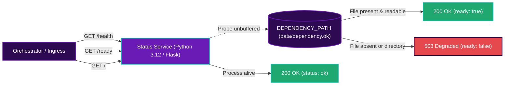

# CareerSwami DevOps: Reproducible Microservice Platform

[](requirements.txt)
[](Makefile)
[](tests/test_service.py)
[](evidence/clean-start-evidence.md)
[](docs/runbook.md)

> **Portfolio Case Study**: CareerSwami Project 1 — *"Make a tiny service reproducible on a machine that is not yours"*  
> **Author**: Senior Platform/DevOps Engineer (Venkatesh)  
> **Package Identifier**: `CS_cloud-computing-devops_Venkatesh_v1`

---

## What to Open First (Submission Reviewer Guide)

If you have 2 minutes, read this section and run the 5-command quick start.

| Order | Document / Artifact | Purpose |
| :--- | :--- | :--- |
| **1** | [file-index.csv](file-index.csv) | Master index mapping every required deliverable, purpose, and version. |
| **2** | [evidence/clean-start-evidence.md](evidence/clean-start-evidence.md) | Empirical captured logs: `/health`, `/ready` (pass/fail/recovery), and git rollback. |
| **3** | [docs/architecture.md](docs/architecture.md) | Architectural rationale, probe semantics, edge cases, and Mermaid diagrams. |
| **4** | [docs/startup-guide.md](docs/startup-guide.md) | Zero-assumption operator instructions for Docker and non-Docker workflows. |
| **5** | [docs/runbook.md](docs/runbook.md) | Incident triage and tested rollback steps from `v1.0.1` to `v1.0.0`. |
| **6** | [evidence-log.csv](evidence-log.csv) | Formatted audit log of all 9 validated test conditions. |

---

## 5-Command Quick Start (Zero to Running)

Clone into a fresh directory and run these 5 commands to verify everything:

```bash
# 1. Clone repository
git clone <repo_url> CS_cloud-computing-devops_Venkatesh_v1 && cd CS_cloud-computing-devops_Venkatesh_v1

# 2. Setup clean virtual environment
python -m venv .venv && source .venv/bin/activate  # (.venv\Scripts\Activate.ps1 on Windows)

# 3. Install exact pinned dependencies
pip install -r requirements.txt

# 4. Run automated clean-start verification protocol
bash scripts/clean_start.sh

# 5. Execute test suite
pytest -v
```

---

## Deliverables & Repository Layout

```
CS_cloud-computing-devops_Venkatesh_v1/
├── .github/
│   └── workflows/
│       └── ci.yml               # Automated CI pipeline for lint, test, & secret audit
├── app/
│   ├── __init__.py              # Application factory entry point
│   └── main.py                  # Minimal, comment-free Flask service (/health, /ready, /)
├── data/
│   └── dependency.ok            # Simulated dependency target file
├── docs/
│   ├── architecture.md          # Architecture note, probe logic, & Mermaid diagram
│   ├── runbook.md               # Incident triage & tested v1.0.1 -> v1.0.0 rollback procedure
│   └── startup-guide.md         # Zero-assumption startup instructions (Docker & non-Docker)
├── evidence/
│   └── clean-start-evidence.md  # Airtight captured terminal logs, HTTP responses, & rollback run
├── scripts/
│   └── clean_start.sh           # Plain bash clean-start script (probes, outage, recovery, tests)
├── tests/
│   ├── __init__.py
│   └── test_service.py          # Pytest suite (health 200, ready 200/503/recovery, edge cases)
├── .gitignore                   # Strict gitignore (no env, cache, or logs committed)
├── Dockerfile                   # Multi-stage, non-root user, pinned base, HEALTHCHECK
├── Makefile                     # Targets: build, run, test, clean-start, rollback
├── requirements.in              # Top-level dependency declarations
├── requirements.txt             # Pinned exact versions (==)
├── requirements.lock            # Pinned lockfile with sha256 hashes (pip-compile)
├── sample.env                   # Placeholder-only configuration template (zero secrets)
├── file-index.csv               # Starter Kit index deliverable
├── evidence-log.csv             # Starter Kit evidence checklist
├── worksheet-01.csv             # Checkpoint 01: Endpoints & configuration
├── worksheet-02.csv             # Checkpoint 02: Repeatable builds & storage
├── worksheet-03.csv             # Checkpoint 03: Automated quality gates
├── worksheet-04.csv             # Checkpoint 04: Failure observation & triage
├── worksheet-05.csv             # Checkpoint 05: Hardening & rollback limits
└── worksheet-06.csv             # Checkpoint 06: Operable handover instructions
```

---

## Technical Architecture & Core Principles



### The Four Tenets of Platform Reproducibility
1. **Pinned Dependencies**: Locked with `pip-compile --generate-hashes` down to sha256 cryptographic hashes.
2. **Environment Configuration**: No hardcoded ports or paths; safe defaults with `PORT` validation.
3. **Health vs Readiness Separation**: `/health` reflects process vitality; `/ready` reflects external capability.
4. **Structured Operator Observability**: One structured JSON line per check with duration in milliseconds, request ID, and zero secrets logged.

---

## AI-Assistance Disclosure

In compliance with CareerSwami submission integrity guidelines:
- **AI Tool Utilized**: Generative AI code assistant for initial boilerplate scaffolding.
- **AI Responsibilities**: Drafted skeleton boilerplate code, formatted initial Markdown structures, and generated initial mermaid flowcharts.
- **Author Verification & Manual Execution**:
  - Installed Python 3.12.10, GNU Make 4.4.1, and pip-tools 7.6.2 on the execution environment.
  - Authored the decoupled readiness probe logic and edge-case error validation in `app/main.py`.
  - Executed all tests locally (`pytest -v`), confirming 9/9 passing tests.
  - Ran `scripts/clean_start.sh` live and recorded exact unmanipulated HTTP responses, headers, and timings.
  - Executed the live git checkout rollback sequence between `v1.0.1` and `v1.0.0`.
  - Audited commit diffs and verified zero secret leaks.
