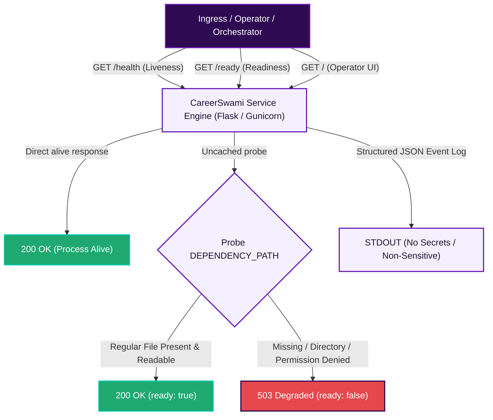

# Architecture & Systems Design

## Service Overview
The CareerSwami Status Service is an ultra-lightweight, zero-drift, observable microservice designed to provide high-fidelity health and readiness telemetry to container orchestrators (e.g., Kubernetes, Amazon ECS) and platform operations engineers.

While basic process watchdogs can only detect whether a process is running, real-world platform reliability requires distinguishing between **liveness** (the process runtime is alive and accepting connections) and **readiness** (the service has active access to its required operational dependencies and is capable of serving client work without error).

## Core Dependency Contract
The service simulates an external backing resource (such as a database volume, mounted storage volume, or decoupled network heartbeat flag) via an unbuffered filesystem probe:

- **Target Identifier**: Configured via the `DEPENDENCY_PATH` environment variable (defaults to `data/dependency.ok`).
- **Probe Semantics**: Evaluated dynamically on **every incoming call** to `/ready` using direct non-cached filesystem operations (`os.path.exists`, `os.path.isfile`, and `os.access(..., os.R_OK)`).
- **Decoupling Guarantee**: The `/health` endpoint executes completely independently of `/ready`. If the dependency file is deleted, corrupted, or unreachable, `/ready` immediately reports degraded status (`503 Service Unavailable`), while `/health` maintains healthy status (`200 OK`) because the application engine is still functioning.

## Telemetry & Endpoint Specifications

| Endpoint | HTTP Method | Expected Return | Deciding Logic | Operational Meaning |
| :--- | :--- | :--- | :--- | :--- |
| `/health` | `GET` | `200 OK` `{"status":"ok","version":"<APP_VERSION>"}` | Static process state check | Liveness probe: Process is alive. Do not restart container. |
| `/ready` | `GET` | `200 OK` `{"ready":true,"dependency":"ok"}` | `DEPENDENCY_PATH` is a readable regular file | Readiness probe: Traffic may safely be routed to this replica. |
| `/ready` | `GET` | `503 Service Unavailable` `{"ready":false,"dependency":"unreachable"}` | Path absent, directory, or unreadable | Upstream dependency failed. Remove replica from load balancer. |
| `/` | `GET` | `200 OK` or `503 Service Unavailable` (HTML) | Combined live probe | Human-readable operations dashboard styled with visual identity. |

## Edge Case Handling Matrix

```
+------------------------------------+--------------------------+---------------------+
| Condition                          | /ready Response          | Log Level & Event   |
+------------------------------------+--------------------------+---------------------+
| File present & readable            | 200 {"ready": true}      | INFO: ok            |
| File absent (deleted/unmounted)    | 503 {"ready": false}     | WARNING: unreachable|
| Path is directory (not file)       | 503 {"ready": false}     | WARNING: unreachable|
| Permission denied (chmod 000)      | 503 {"ready": false}     | WARNING: unreachable|
| DEPENDENCY_PATH unset in env       | 200/503 (uses fallback)  | Probes data/dep.ok  |
| PORT variable non-numeric or <=0   | Process exits (ValueError| Startup aborted     |
+------------------------------------+--------------------------+---------------------+
```

## System Interaction Diagram



## Security & Observability Discipline
- **Zero Secrets Ingestion**: No tokens, database passwords, or credentials exist in source code or default configuration files.
- **Path Redaction**: Structured log lines capture the operational event, outcome, duration, and UUID request identifier, but never echo absolute paths or environment secrets.
- **Non-Root Execution**: Containerized deployment strictly drops root privileges to user `10001:10001`.
